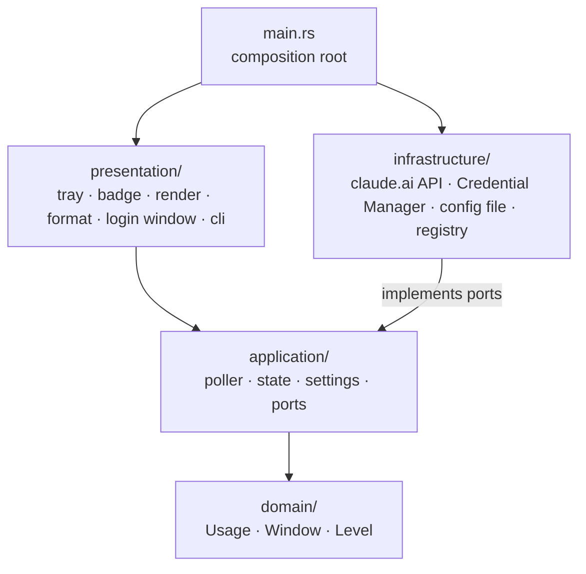

# claude-meter

A tiny Windows tray app, written in Rust, that always shows how much of your Claude plan's usage you have left: the 5-hour session limit and the weekly limit. It works whether you chat in the Claude desktop app or on claude.ai.

> **Status:** Milestone 2 is done: tray icon, floating badge, background polling, sign-in from the tray, and start with Windows.

## What you see
- **Tray icon:** your session percent on a green, amber or red tile (whichever limit is most urgent sets the color), with the weekly percent as a bar along the bottom. A gray tile means the last update failed, and `?` means you're signed out.
- **Tooltip and menu:** session and weekly usage with reset times, any extra limits claude.ai reports (for example a weekly cap on one model), and which products used this week's allowance (for example "Claude Code 88% · Cowork 12%").
- **Floating badge:** a small always-on-top window with a bar for each limit. Drag it anywhere, and right-click it for the menu. **Compact badge** shrinks it to one line.
- **Menu:** Refresh now, Open usage page, Sign in / Sign out, Show badge, Compact badge, Start with Windows, Quit.

## Goals
- Under 10 MB of RAM and about 0% CPU when idle: no async runtime and no GUI framework. (Measured: about 5 MB private memory and 0 CPU between polls.)
- One-time sign-in in a small claude.ai login window. The session is stored in Windows Credential Manager, never in a file.

## Build
Requires Rust (`winget install Rustlang.Rustup`), the Visual Studio C++ build tools that Rust's MSVC toolchain needs, and the WebView2 runtime (built into Windows 11).

```bash
cargo test
cargo run                        # run in the system tray (signs in on first run)
cargo run -- --once              # print current usage once and exit
cargo run -- --logout            # forget the saved session
cargo build --release            # target\release\claude-meter.exe, no console window
```

Google, Apple and email sign-in all work in the sign-in window.

## How it works
claude.ai's Settings → Usage page reads `GET /api/organizations/{org}/usage?via=plan`. claude-meter calls the same endpoint with your session cookie, once a minute by default (`interval_secs` in the config, never below 30 seconds), and backs off up to 10 minutes after errors. It's an undocumented endpoint, so parsing is tolerant and may need updates if claude.ai changes it.

## Architecture
A layered monolith with the business logic in the middle. The application layer defines traits (ports) for everything it needs from outside, and the infrastructure layer implements them, so the core is tested with fakes instead of the network or Windows.



| Layer | Holds | Depends on |
| --- | --- | --- |
| `domain/` | Usage windows, limits, urgency levels and thresholds. Pure, no I/O | nothing |
| `application/` | Use cases: the poll and backoff loop (`poller.rs`), app state and sign-in/out (`state.rs`), settings data, and the ports (`ports.rs`: `UsageSource`, `SessionStore`, `SettingsStore`, `Autostart`) | domain |
| `infrastructure/` | Adapters: claude.ai over HTTP (`ureq`, tolerant JSON parsing), Windows Credential Manager, `%APPDATA%\claude-meter\config.toml`, the per-user `Run` registry value | application, domain |
| `presentation/` | Tray icon and menu, floating badge (`softbuffer`, `tiny-skia`, Segoe UI via `ab_glyph`), text formatting, WebView2 sign-in window, `--once`/`--logout` | application, domain |
| `main.rs` | Picks the real adapters and hands them to the presentation layer | everything |

`tests/architecture.rs` fails the build if a layer imports one it shouldn't, or if `domain/` or `application/` use UI, HTTP or Windows crates.

Not affiliated with Anthropic.
